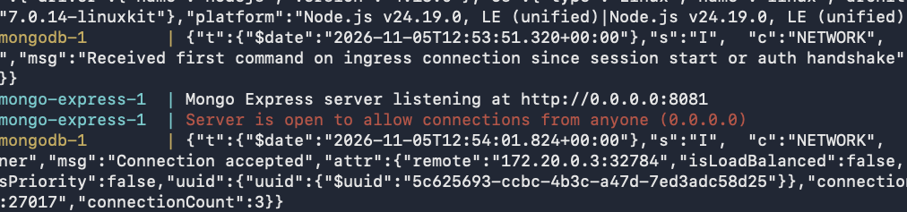
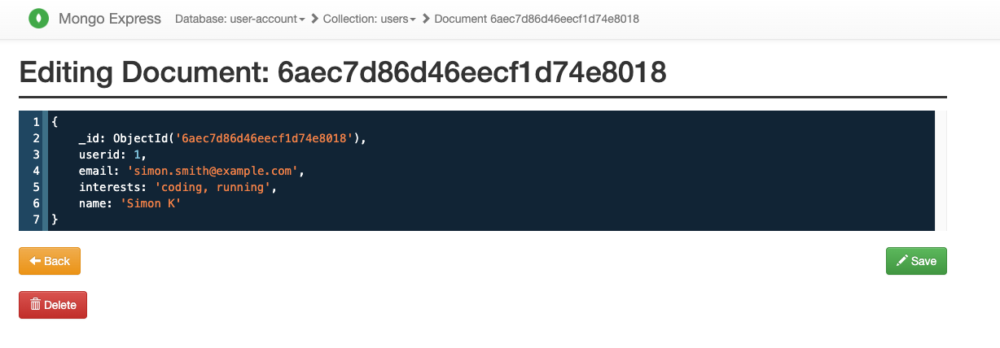
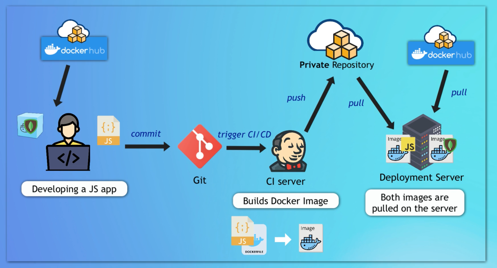

## demo app - developing with Docker

This demo app shows a simple user profile app set up using 
- index.html with pure js and css styles
- nodejs backend with express module
- mongodb for data storage

All components are docker-based

### With Docker

#### To start the application

Step 1: Create docker network

    docker network create mongo-network 

Step 2: start mongodb 

    docker run -d -p 27017:27017 -e MONGO_INITDB_ROOT_USERNAME=admin -e MONGO_INITDB_ROOT_PASSWORD=password --name mongodb --net mongo-network mongo    

Step 3: start mongo-express
    
    docker run -d -p 8081:8081 -e ME_CONFIG_MONGODB_ADMINUSERNAME=admin -e ME_CONFIG_MONGODB_ADMINPASSWORD=password --net mongo-network --name mongo-express -e ME_CONFIG_MONGODB_SERVER=mongodb -e ME_CONFIG_MONGODB_URL=mongodb://mongodb:27017 mongo-express   

_NOTE: creating docker-network in optional. You can start both containers in a default network. In this case, just emit `--net` flag in `docker run` command_

Step 4: open mongo-express from browser

    http://localhost:8081

Step 5: create `user-account` _db_ and `users` _collection_ in mongo-express

Step 6: Start your nodejs application locally - go to `app` directory of project 

    cd app
    npm install 
    node server.js
    
Step 7: Access you nodejs application UI from browser

    http://localhost:3000

### With Docker Compose

#### To start the application

Step 1: start mongodb and mongo-express

    docker-compose -f docker-compose.yaml up
    
_You can access the mongo-express under localhost:8080 from your browser_
    
Step 2: in mongo-express UI - create a new database "user-account"

Step 3: in mongo-express UI - create a new collection "users" in the database "user-account"       
    
Step 4: start node server 

    cd app
    npm install
    node server.js
    
Step 5: access the nodejs application from browser 

    http://localhost:3000

#### To build a docker image from the application

    docker build -t my-app:1.0 .       
    
The dot "." at the end of the command denotes location of the Dockerfile.

# Docker container project notes

# 1. Use Docker for Local Development

Containerized a Node.js application with Docker and ran it locally alongside a MongoDB database and a Mongo Express admin UI.

**Tech:** Docker · Node.js · MongoDB · Mongo Express

 

## What I did

- Created a Dockerfile for a Node.js application and built a Docker image
- Ran the Node.js app in a Docker container and connected it to a MongoDB database container locally
- Ran a Mongo Express container as a UI for the MongoDB database

 

## Skills demonstrated

Containerization with Docker, Dockerfile authoring, multi-container local development, Docker networking, working with MongoDBd

 

## Architecture:

## MongoDB + Mongo Express:

## Running App:

 

# 2. Docker Compose - Run multiple Docker containers

This project uses Docker Compose to run MongoDB and Mongo Express together with a single configuration file.

**Tech:** Docker · MongoDB · Mongo Express

 

## What I did

- Wrote a Docker Compose file to configure and run the MongoDB and Mongo Express containers
- Defined the services, ports, and environment variables needed for the containers to communicate

 

 

 

# 3. Dockerize Nodejs application

Dockerized a Node.js application by building and running it as a container.

**Tech:** Docker · Node.js

 

## What I did

- Wrote a Dockerfile to build a Docker image for the Node.js application
- Ran the application in a Docker container

 

 

 

 

# 4. Create Docker repository on Nexus and push to it

Created a private Docker registry on Nexus and pushed a Docker image to it from a DigitalOcean server.

**Tech:** Docker · Nexus · DigitalOcean · Linux

 

## What I did

- Created a hosted Docker repository and a Docker repository role in Nexus
- Created a Nexus user with permission to push images to the repository
- Connected Nexus, a DigitalOcean Droplet, and Docker so the server could authenticate with the registry
- Built and pushed a Docker image to the Nexus repository

 

_Docker image being pushed to the Nexus repository._

 

_Docker image successfully available in the Nexus repository._

 

# Deploy Docker application on a server with Docker compose

Deployed a Docker Compose application to a remote server, including the Node.js app, MongoDB, and Mongo Express.

**Tech:** Docker · Node.js · MongoDB · Mongo Express

 

## What I did

- Copied the Docker Compose configuration to the remote server
- Logged in to the private Docker registry so the server could pull the application image
- Started the application, MongoDB, and Mongo Express services with Docker Compose
- Verified that the deployed application and database services were running successfully

 

*Docker Compose services running on the remote server.*

 

*Application data verified through Mongo Express after deployment.*

 

*Overview of the build, registry, and deployment workflow.*
