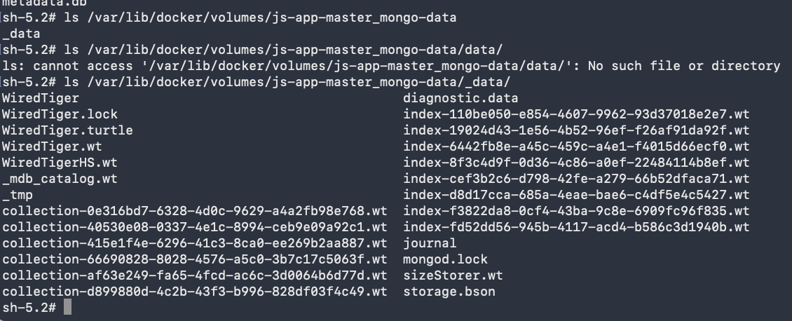
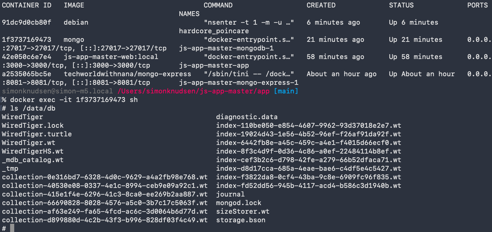

# 1. Use Docker for Local Development

Containerized a Node.js application with Docker and ran it locally alongside a MongoDB database and a Mongo Express admin UI.

**Tech:** Docker · Node.js · MongoDB · Mongo Express

 

## What I did

- Created a Dockerfile for a Node.js application and built a Docker image
- Ran the Node.js app in a Docker container and connected it to a MongoDB database container locally
- Ran a Mongo Express container as a UI for the MongoDB database

 

## Architecture:

## MongoDB + Mongo Express:

## Running App:

 

# 2. Docker Compose - Run multiple Docker containers

This project uses Docker Compose to run MongoDB and Mongo Express together with a single configuration file.

**Tech:** Docker · MongoDB · Mongo Express

 

## What I did

- Wrote a Docker Compose file to configure and run the MongoDB and Mongo Express containers
- Defined the services, ports, and environment variables needed for the containers to communicate

 

 

 

# 3. Dockerize Nodejs application

Dockerized a Node.js application by building and running it as a container.

**Tech:** Docker · Node.js

 

## What I did

- Wrote a Dockerfile to build a Docker image for the Node.js application
- Ran the application in a Docker container

 

 

 

 

# 4. Create Docker repository on Nexus and push to it

Created a private Docker registry on Nexus and pushed a Docker image to it from a DigitalOcean server.

**Tech:** Docker · Nexus · DigitalOcean · Linux

 

## What I did

- Created a hosted Docker repository and a Docker repository role in Nexus
- Created a Nexus user with permission to push images to the repository
- Connected Nexus, a DigitalOcean Droplet, and Docker so the server could authenticate with the registry
- Built and pushed a Docker image to the Nexus repository

 

_Docker image being pushed to the Nexus repository._

 

_Docker image successfully available in the Nexus repository._

 

# 5. Deploy Docker application on a server with Docker compose

Deployed a Docker Compose application to a remote server, including the Node.js app, MongoDB, and Mongo Express.

**Tech:** Docker · Node.js · MongoDB · Mongo Express

 

## What I did

- Copied the Docker Compose configuration to the remote server
- Logged in to the private Docker registry so the server could pull the application image
- Started the application, MongoDB, and Mongo Express services with Docker Compose
- Verified that the deployed application and database services were running successfully

 

_Docker Compose services running on the remote server._

 

_Application data verified through Mongo Express after deployment._

 

_Overview of the build, registry, and deployment workflow._

 

# 6. Pesist data with Docker Volumes

Persisted MongoDB data outside the container by attaching a Docker volume to the database service.

**Tech:** Docker · Node.js · MongoDB

 

## What I did

- Created and attached a Docker volume to the MongoDB container
- Mounted the volume at MongoDB's data directory so database files are stored independently of the container
- Verified that the same data is available from both the Docker volume and the running MongoDB container

 

*MongoDB data files persisted in the local Docker volume.*

 

*The same persisted data is available inside the MongoDB container.*
