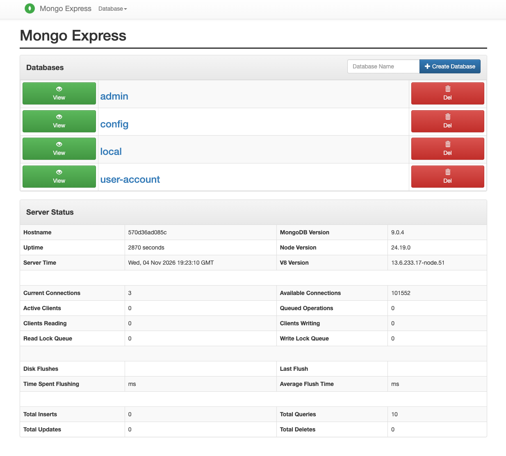
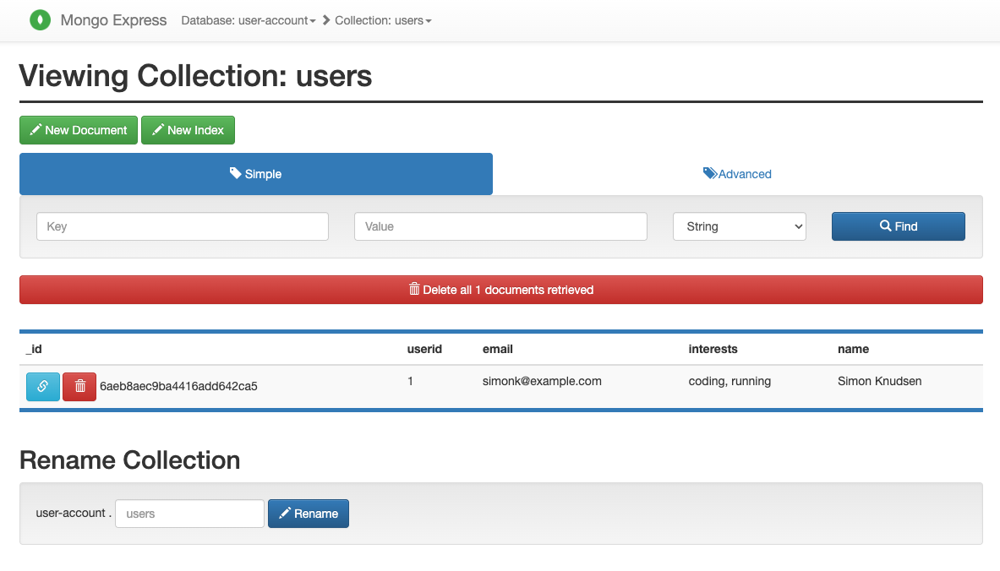
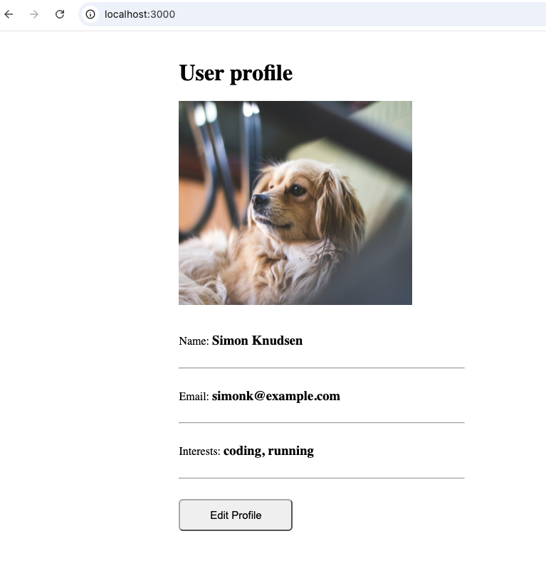

# 1. Use Docker for Local Development

Containerized a Node.js application with Docker and ran it locally alongside a MongoDB database and a Mongo Express admin UI.

**Tech:** Docker · Node.js · MongoDB · Mongo Express

## What I did

- Created a Dockerfile for a Node.js application and built a Docker image
- Ran the Node.js app in a Docker container and connected it to a MongoDB database container locally
- Ran a Mongo Express container as a UI for the MongoDB database

## Skills demonstrated

Containerization with Docker, Dockerfile authoring, multi-container local development, Docker networking, working with MongoDBd

## Architecture:

## MongoDB + Mongo Express:

## Running App:

